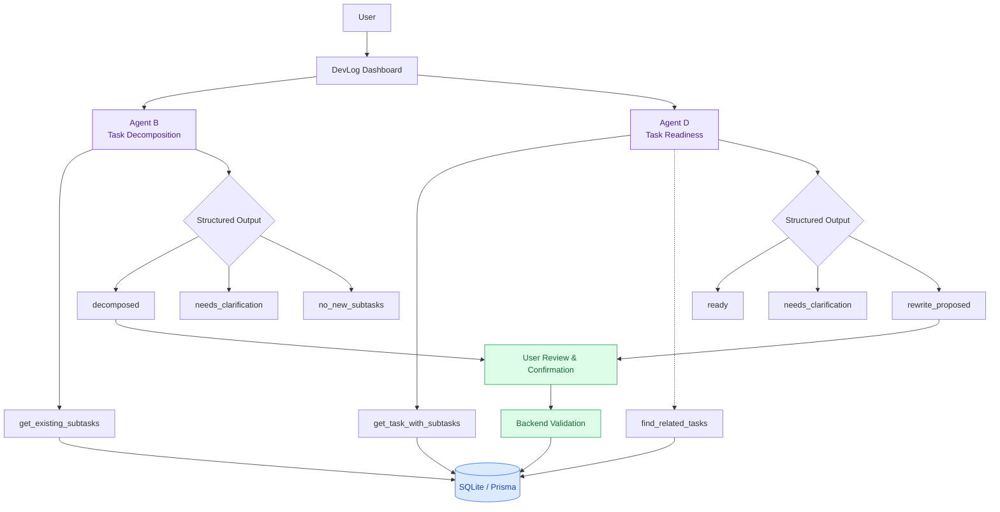

# DevLog

DevLog is a local, single-user task tracker with nested subtasks and two AI-assisted workflows for task decomposition and readiness analysis.

## Getting Started

### Prerequisites

- Node.js 24 (tested development environment)
- npm
- OpenAI API key (required for AI features)

### Installation

Clone the repository and install dependencies:

```bash
git clone <repository-url>
cd DevLog
npm install
```

Start the development server:

```bash
npm run dev
```

Open [http://localhost:3000](http://localhost:3000).

### Database Configuration

DevLog uses SQLite as its local database. No external database server is required.

By default, the database is stored at `prisma/dev.db`.

The project automatically prepares the database:

- `npm install` generates the Prisma Client through the `postinstall` script.
- `npm run dev` ensures the SQLite database file exists and applies pending Prisma migrations before starting Next.js.

No separate database initialization commands are required.

### Environment Variables

Create a `.env` file in the project root using `.env.example` as a reference.

```ini
DATABASE_URL="file:./dev.db"
LLM_PROVIDER="openai"
OPENAI_API_KEY="your-openai-api-key"
OPENAI_MODEL="your-openai-model"
TASK_READINESS_SNAPSHOT_SECRET=""
```

| Variable | Description |
| --- | --- |
| `DATABASE_URL` | SQLite database connection. Defaults to `file:./dev.db`. |
| `LLM_PROVIDER` | AI provider. The implemented integration uses `openai`. |
| `OPENAI_API_KEY` | OpenAI API key used for Agent B and Agent D. |
| `OPENAI_MODEL` | OpenAI model used for agent execution. |
| `TASK_READINESS_SNAPSHOT_SECRET` | Optional server-side secret for signing Agent D rewrite confirmation snapshots. |

Regular task-management operations work without OpenAI credentials. Agent B and Agent D require a valid API key and model configuration.

Do not commit real API keys or other secrets to the repository.

### Available Commands

| Command | Description |
| --- | --- |
| `npm run dev` | Prepare the database and start the development server |
| `npm run build` | Create a production build |
| `npm run start` | Start the production server |
| `npm run lint` | Run ESLint |
| `npm test` | Run the Vitest test suite |

## Architecture & API Overview

DevLog uses the Next.js App Router for the UI and Route Handlers for the REST API. Requests pass through Zod runtime validation and focused services before Prisma accesses the local SQLite database. The dashboard entry point is `src/app/page.tsx`.

### Agent Workflow



### Task CRUD

| Method | Endpoint | Purpose |
| --- | --- | --- |
| `GET` | `/api/tasks` | List root tasks with nested subtasks, filters, and sorting. |
| `POST` | `/api/tasks` | Create a root task or one-level subtask. |
| `GET` | `/api/tasks/:taskId` | Retrieve one task. |
| `PATCH` | `/api/tasks/:taskId` | Update editable task fields. |
| `DELETE` | `/api/tasks/:taskId` | Delete a task; deleting a root task cascades to its subtasks. |

### AI Workflows

| Method | Endpoint | Purpose |
| --- | --- | --- |
| `POST` | `/api/tasks/:taskId/decomposition-preview` | Run Agent B and return a read-only decomposition preview. |
| `POST` | `/api/tasks/:taskId/decomposition-confirm` | Validate and atomically create confirmed subtasks. |
| `POST` | `/api/tasks/:taskId/readiness-analysis` | Run Agent D and return a read-only readiness result. |
| `POST` | `/api/tasks/:taskId/readiness-confirm` | Validate and apply a confirmed title/description rewrite. |

## In-Product Agent Design

### Agent B — Task Decomposition

Agent B analyzes a root task and proposes subtasks representing the work that remains within its defined scope.

**Execution flow**

1. The user starts decomposition for a root task.
2. The backend loads the task's title, description, priority, and existing-subtask count.
3. The OpenAI model evaluates whether the task contains enough information.
4. When existing subtasks are present, the agent must call `get_existing_subtasks` to inspect their coverage.
5. The agent produces a structured result.
6. The user reviews and optionally edits proposed subtasks before confirming their creation.

**Tools and execution limits**

- `get_existing_subtasks`: read-only access to the current task's existing subtasks.
- Maximum 2 model turns.
- Maximum 1 tool call.
- Maximum 2 clarification rounds.

When no existing subtasks are present, the model can produce a result without calling a tool.

**Structured output**

Agent B supports three outcomes:

- `decomposed`: proposes 1–7 subtasks.
- `needs_clarification`: returns questions about missing requirements.
- `no_new_subtasks`: explains why no additional subtasks are justified.

The output is validated using Zod schemas. The backend also checks task eligibility, clarification limits, duplicate titles, and required tool execution.

The agent cannot create subtasks directly. The confirmation endpoint validates the user's edited proposals and checks the latest database state before creating subtasks in a transaction.

**Stopping conditions**

Agent B stops when it generates a valid outcome, reaches its execution limits, or encounters a provider or validation failure. If clarification is required, the user can provide answers and start another bounded analysis.

### Agent D — Task Readiness

Agent D evaluates whether a task is sufficiently specified for implementation and objective verification.

It examines five criteria:

1. Clarity.
2. Scope.
3. Acceptance criteria.
4. Testability.
5. Dependencies.

**Execution flow**

1. The user starts a readiness check for a task or subtask.
2. The agent must inspect the current task and its subtasks.
3. It may search related tasks when dependencies or potential conflicts require additional context.
4. It evaluates the five readiness criteria.
5. It returns a structured readiness outcome.
6. If a rewrite is proposed, the user can edit and explicitly confirm it.

**Tools and execution limits**

- `get_task_with_subtasks`: mandatory, read-only task inspection.
- `find_related_tasks`: optional, read-only search for potentially related tasks.
- Maximum 4 model turns.
- Maximum 4 tool calls.
- Maximum 2 clarification rounds, with up to 3 questions per round.
- Related-task search returns at most 10 results.

The initial task-inspection tool call is mandatory. Further tool use depends on the model's assessment, within the configured limits.

**Structured output**

Agent D supports three outcomes:

- `ready`: the task contains sufficient requirements.
- `needs_clarification`: specific product decisions or requirements are missing.
- `rewrite_proposed`: the agent suggests an improved title and description.

The backend validates model responses with strict Zod schemas and independently enforces tool-use requirements, clarification limits, and outcome consistency.

Technical failures are handled separately from successful readiness outcomes.

**Stopping conditions**

Agent D stops after producing a validated outcome or reaching its execution limits.

When clarification rounds are exhausted, the application displays the unresolved requirements and preserves the user's previous answers. This is handled as an expected workflow state.

A proposed rewrite is never applied automatically. Confirmation uses a signed snapshot and checks that the task has not changed since the analysis. Only the title and description can be updated.

### Handling Unexpected Agent Behavior

**Case 1 — Agent B proposes unnecessary work**

During testing, Agent B suggested additional authentication features even though several existing subtasks already covered the defined requirements.

The original schema required at least two generated subtasks, which encouraged unnecessary output.

The correction introduced `no_new_subtasks`, reduced the minimum to one, and made existing-subtask inspection mandatory when subtasks already exist.

The product also requires explicit user confirmation before any generated subtask is saved.

**Case 2 — Agent D requests unnecessary clarification**

During manual testing, Agent D asked users to decide ordinary technical implementation details that did not affect observable product behavior.

Its instructions were adjusted to distinguish missing product requirements from implementation choices.

The correction also improved the terminal clarification workflow: after two rounds, the UI displays specific unresolved requirements and retains submitted answers for review.

In both agents, structured validation, bounded execution, and explicit confirmation limit the consequences of incorrect or unexpected model output.

## Decisions and Trade-offs

### 1. SQLite and Prisma

**Reasons for the choice:**

- DevLog is a local, single-user application that does not require a separate database server.
- SQLite provides persistent task storage between application restarts.
- SQL supports filtering, sorting, and updating records.
- A JSON-based solution would require custom logic for reading, updating, and saving records, including handling write conflicts.
- In-memory storage would not satisfy the requirement to preserve data after a restart.
- I had used Prisma before and already had experience with its schemas and migrations.
- Switching to Drizzle did not provide an obvious advantage for this MVP.

**Trade-off:** SQLite is suitable for a local application, but PostgreSQL could be considered if the system needed to support multiple users and concurrent writes.

### 2. Next.js Instead of a Separate Express Server

**Reasons for the choice:**

- The DevLog backend has limited responsibilities: CRUD operations, database access, and the APIs for two agents.
- Next.js Route Handlers provide everything needed to implement the required endpoints.
- The frontend and backend remain in a single project.
- A separate Express server would increase configuration and maintenance complexity.
- At the current application scale, I did not see a meaningful advantage in separating the server and client into different projects.

**Trade-off:** If the system grows significantly, a separate backend could be considered.

### 3. Separate Agent B and Agent D

**Reasons for the choice:**

- The agents perform different functions.
- Agent B decomposes tasks.
- Agent D evaluates whether tasks are ready for implementation.
- Users do not always need both operations.
- Each agent is started separately when requested by the user.
- Keeping them separate allows each function to have its own instructions, tools, and execution limits.
- The agents do not need to perform many unrelated operations within a single workflow.

**Trade-off:** Two agents require separate contracts and tests, and some infrastructure is duplicated.

### 4. Limits on Model Turns, Tool Calls, and Clarification Rounds

**Reasons for the choice:**

- Every additional model request increases API costs.
- Unbounded execution could cause unnecessary repeated steps.
- Execution limits make resource usage more predictable.
- Too many clarification questions would create a poor user experience.
- Two clarification rounds are a reasonable limit for an interactive workflow.
- If the requirements remain unclear after that, the user can update the task manually.

**Trade-off:** In some cases, an agent may be unable to complete its analysis within the configured limits.

Agent B allows 2 model turns and 1 tool call. Agent D allows 4 model turns and 4 tool calls because it may also investigate related tasks.

### 5. Confirmation Before Saving AI-Generated Changes

**Reasons for the choice:**

- The user remains responsible for the content of their tasks.
- AI may misunderstand the requirements or propose unnecessary work.
- The user must be able to review, edit, or reject a suggestion.
- Agent B does not create subtasks automatically.
- Agent D does not apply a rewritten description without confirmation.
- Database changes occur only after a separate user action.

**Trade-off:** An additional confirmation step increases the number of user actions, but reduces the risk of unwanted changes.

Agent D also checks whether the task has changed since the analysis so that it does not apply a stale result.
